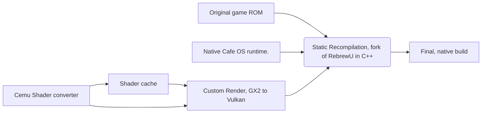

# Splatoon 1 🦑 PC Port
     
## The original repo is https://github.com/ApfelTeeSaft/RebrewU , Our Splatoon 1 PC Port is simply a continuation of ApfelTeeSaft's RebrewU Project

> IF YOU WANT TO HELP US DM `sussy_0897` IN DISCORD OR START A FORK (PREFERABLY DM ME ON DISCORD SINCE U MIGHT GET ADDED TO OUR TEAM), **Follow Code of conduct.md**
> IF YOU POST ANYTHING RELATED TO OUR PORT ON TIKTOK TAG @nevesboy67 @77emul AND @splatoon1multiplayer

An unofficial native PC port of **Splatoon (Wii U)** for **Windows and Linux**, made by statically recompiling the game's code into a native program, with a Vulkan renderer.

> **This project contains no Nintendo code, assets or game files.** You need your own copy of the game, dumped from your own Wii U. The setup builds the port on your PC from your files.

> ⚠️ **Work in progress.** Expect graphical glitches, missing effects, stutter and crashes. You need **strong hardware** (see below). If something goes wrong, please [open an issue](https://github.com/NEVESYA/SPLATOON-1-PC-PORT/issues). Include your PC specs and the text from the setup window or a screenshot. **AMD GPUs are not supported**, only NVIDIA

## Features

**Realistic graphics (experimental, off by default)**

Turn it on in the settings menu with *Graphics preset* (Balanced, Realistic or Cinematic); *Original* keeps the clean game at 60 FPS.
- The game's own lights follow a **time of day**: sunrise, golden hour, sunset and night with moon and stars, or the PC clock
- **Weather**: clear, overcast, rain, thunderstorm with lightning, after the rain (wet ground), or *Live*, where it changes by itself
- A physically based **sky** with **volumetric clouds**, two towering cumulus clouds, silver linings and **light shafts** through cloud gaps
- **Contact shadows**, ambient occlusion, bloom, edge smoothing (FXAA + TAA), motion blur, focus blur and colour controls (saturation, contrast, warmth, vignette, saved looks)
- Runs in the **plaza, Octo Valley and the tutorial**; story levels keep their own sky and lights and get the picture effects only

Supported game versions: [VersionDb.md](VersionDb.md) (base game v16 and update 288, EUR). Details of the 288 update: [docs/update-288.md](docs/update-288.md).

## Playing
**Camera, cinema mode and PC controls**
- Field of view, camera distance and height, and a hand-held camera wiggle
- **Cinema mode**: no HUD and a free camera to fly anywhere for screenshots; **F12** saves a photo without menus
- Direct **PC mouse aiming** (1:1, like a PC shooter) and a key for every GamePad input
- Camera spots and character spawn points for testing

**HD textures (optional, built on your PC)**
- `HD-Textures` upscales the textures you saw while playing with Real-ESRGAN into `Game\textures`; nothing is downloaded or shared

**Releases for Windows and Linux**
- The [Releases page](https://github.com/NEVESYA/SPLATOON-1-PC-PORT/releases) provides standalone graphical builder tools for each release:
  - **`SplatPC-Builder-Windows-x64.zip`** for Windows (unzip it and run `SplatPC-Builder.exe`)
  - **`SplatPC-Builder-x86_64.AppImage`** for Linux
  Simply download the builder tool from the release, follow the wizard steps, and build your game without dealing with manual scripts.

**Settings menu (Esc / controller touchpad)**
- Render resolution, Plaza 60 FPS on/off, frame rate (30 / 60 / 120 / 180), G-Sync / FreeSync, fullscreen, performance overlay
- **Graphics preset (experimental):** Original (the clean game at 60 FPS, the default), Balanced, Realistic, Cinematic; pages for graphics, weather & time, camera & mouse, and cinema/photo/hacks, with a help line for every option
- Gyro on/off, gyro and mouse sensitivity, invert gyro, volume
- Rebind every button for keyboard/mouse and controller
- HOME moved from Esc to H

**Performance**
- Plaza runs at 60 FPS with normal game speed (keeps NPCs)
- New frame rates in the menu (experimental): 120 and 180 FPS with real extra frames between game steps (180 outside the plaza), 30 FPS for weak PCs; game speed stays normal in all
- Fewer shader stutters, faster rendering in levels

---

**More docs:** [Online play and anti-cheat](docs/ONLINE.md) · [Linux](docs/LINUX.md) · [Builder](docs/BUILDER.md) · [Run your own server](docs/SERVEUR.md) · [Update 288](docs/update-288.md)

## Requirements

- **OS:** Windows 10/11 (64-bit) or modern 64-bit Linux
- **GPU:** Vulkan 1.3 compatible with updated drivers (modern NVIDIA recommended)
- **CPU & RAM:** Modern 6–8 cores CPU or more · 16 GB RAM minimum (32 GB recommended)
- **Storage:** ~40 GB free during build (final game install is ~6 GB)
- **Game Dump:** Supported Splatoon Wii U dump (folders `code`, `content`, `meta` dumped from your console, see [VersionDb](/VersionDb.md))

## Installation

1. Download **SplatPC Builder** from the latest [Release](https://github.com/NEVESYA/SPLATOON-1-PC-PORT/releases):
   - **Windows:** **`SplatPC-Builder-Windows-x64.zip`** (unzip it, then run `SplatPC-Builder.exe`)
   - **Linux:** **`SplatPC-Builder-x86_64.AppImage`** (make it executable: `chmod +x SplatPC-Builder-x86_64.AppImage`)
2. Launch the builder and follow the wizard steps:
   - **Prerequisites:** Automatically checks for required tools and offers to install anything missing.
   - **Base ROM:** Select your official Splatoon v16 dump folder (`code`, `content`, `meta`).
   - **Updates & Mods:** Click **"Add update or mod..."** to layer an official update (e.g. v288) or resource mods.
   - **Configuration:** Set your initial graphics preset, resolution, and output destination folder.
   - **Build:** Click **Build** and let the tool compile your game.
3. Play: Launch **`Splatoon.exe`** (Windows) or **`./Splatoon`** (Linux) in your output directory.

> **Updating:** When a new release comes out, simply download the new builder from Releases and run it again. Your saves (`save/`) and shader cache are always preserved.

---

### Optional: HD textures

Upscales textures captured during gameplay using Real-ESRGAN into `textures/`.
- **SplatPC Builder** detects compatible NVIDIA GPUs and automatically activates HD texturing (CUDA acceleration).
- You can also run the standalone scripts: `HD-Textures.bat` (Windows) or `./HD-Textures.sh` (Linux).

---

## Updates & Mods

Official game updates (such as EUR revision 288) and resource mods are handled directly in **SplatPC Builder**:

1. In the builder's ROM step, select your base Splatoon v16 dump folder.
2. Click **"Add update or mod..."**:
   - **For Updates (e.g. revision 288):** Select your dumped update folder. The builder automatically detects official updates and pairs them with the matching manifest (`Gambit_v288.manifest`).
   - **For Resource Mods:** Mods modifying game resources (custom textures, audio, models, or UI inside `content/` and `meta/`) can also be added as overlay layers in the exact same way.
3. Proceed with the wizard and build. The builder layers and merges everything automatically during compilation without modifying your original files.

> **Note:** **Update-combinator** (`scripts/update_combinator.py`) can also be used as a standalone script to manually merge dumps (see [docs/update-288.md](docs/update-288.md)).

## Controls

**Esc** (or the touchpad button of a PlayStation controller) opens the port's settings menu (ImGui): render resolution (applies at the next start), the graphics preset, plaza 60 FPS on/off, frame rate, G-Sync / FreeSync, fullscreen, performance overlay, controller gyro on/off, gyro sensitivity, inverted gyro up/down, mouse sensitivity, volume and quit. Two pages show and rebind every GamePad input for keyboard & mouse and for the controller: select a row, press Enter/Cross, then the new key or button (a key already in use swaps with the old one; Delete/Square clears; "Reset to defaults" restores the layout below). The game keeps running but gets no input while the menu is open. Choices are saved in `settings.ini` next to the game executable (`Splatoon.exe` / `Splatoon`); an environment variable that is set (for example `RBREW_PLAZA_60FPS`, `RBREW_GYRO`, `RBREW_RENDER_RESOLUTION`) still wins over the file.

**Graphics (experimental).** The default is the original look at 60 FPS. The *Graphics preset* turns on the new lighting: the game's own lights follow a time of day (sunrise, sunset, night with moon and stars) and the weather (clear, overcast, rain, thunderstorm, after the rain, or live), a physically based sky with volumetric clouds and light shafts, contact shadows, ambient occlusion, bloom, edge smoothing and colour controls. This runs in the plaza, Octo Valley and the tutorial; story levels keep their own sky and lights and get the picture effects only. The *Camera & mouse* page has direct PC mouse aiming (needs the game's Motion Controls on), field of view, camera distance/height and a camera wiggle. *Cinema, photo & hacks* hides the HUD and frees the camera (mouse to look, WASD to fly, Space/Ctrl up/down, Shift faster, F7 back), takes photos (**F12**, saved to `Screenshots`), and saves/restores camera spots and character spawn points. Every new effect has an environment switch back to the original behaviour (see `docs/performance.md`).

The game starts in borderless fullscreen; **F11** switches to a 1280×720 window and back. The TV scene renders internally at the console's **1280×720** (light on the GPU) and is scaled to the window. For a sharper image set `RBREW_RENDER_RESOLUTION` before starting: `native` (your desktop resolution), `1080p`, `1440p` or any `WIDTHxHEIGHT`. The game's camera and UI keep their original layout.

Controllers (Xbox, PlayStation or any SDL2 controller): buttons are mapped by position, like on the Wii U GamePad. The right stick controls the camera.

The tutorial keeps its original camera behavior, controlled with the **right stick or mouse**. Outside the tutorial, including the plaza, the port applies **neutral camera sensitivity (0)** automatically and uses the motion-control setting stored in your save (change it in the game options). It saves only the sensitivity and the updated checksum; progress, character data, camera inversion and other settings are preserved. The first edited save is backed up as `save.dat.before-control-defaults`. A new save is still created by the game normally.

Keyboard and mouse (default layout, rebindable in the menu):

| Input | Action |
|---|---|
| W A S D | Move |
| Mouse | Aim / camera |
| Left click | Shoot (ZR) |
| Right click | Squid form (ZL) |
| Space | Jump (B) |
| Q | Sub weapon |
| E | Special |
| F | Map (+) |
| G | Options (−) |
| Esc | Settings menu |
| H | Home |
| Tab | GamePad view (the mouse becomes the touch screen) NOT WORKING YET|
| F3 | Show/hide the debug overlay (ImGui windows: FPS, frame time, 1% low, frame-time graph, waits, RAM, shader compiles and diagnostics). |
| F8 / F9 | Start/stop an extended diagnostic recording / save a diagnostic snapshot to `Game/Diagnostics` |

## Runtime switches

| Category / Variable | Options / Default | Description |
| --- | --- | --- |
| **`RBREW_PAIRED_INLINE`** | `0` *(Default: compile-time decode)* | Restores interpreted paired-single instructions for A/B comparisons. |
| **`RBREW_QUERY_ASYNC`** | `0` | Forces all queued occlusion-query reads to wait. |
| **`RBREW_SCAN_COPY`** | `0` | Controls scan copy behavior. |
| **`RBREW_STICK_GYRO_YAW`** | `1` | Enables gyro yaw tied to the stick. |
| **`RBREW_AC_CONNECT`** | `ok` | Simulates the legacy online connection attempt at boot. |
| **`RBREW_BLEND_COMBINE_OLD`** | `1` | Uses the legacy blend combine method. |
| **`RBREW_SCAN_SLICE_MATCH`** | `0` | Disables scan slice matching. |
| **`RBREW_STREAMOUT_FLUSH_PUBLISH`** | `1` | Enables immediate stream-out flush publishing. |
| **`RBREW_FRAME_PACING`** | `0`, `auto`, `vsync` | Configures frame pacing: `0` (no flip pacing), `auto` (holds 30 FPS in heavy scenes), `vsync` (console-strict). |
| **`RBREW_AX_FILTERS`** | `0` | Disables AX audio filters. |
| **`RBREW_GYRO_INVERT_PITCH`** | `1` | Inverts gyro pitch control. |
| **`RBREW_GYRO_INVERT_YAW`** | `1` | Inverts gyro yaw control. |
| **`RBREW_STREAMOUT_EAGER`** | `1` | Uses legacy per-draw stream-out readback. |
| **`RBREW_IDLE_LOOKAROUND`** | `1` | Plays the inkling's look-around idle animation |
| **`RBREW_FPS_OVERLAY`** | `0` | Disables the FPS counter overlay. |
| **`RBREW_ASYNC_SHADERS`** | `0` | Waits for every shader compile instead of skipping the draw call. |
| **`RBREW_PLAZA_60FPS`** | `0`, `1` | Plaza frame rate mode: `0` (console-native 30 FPS), `1` (locked 60 FPS mode). |
| **`RBREW_FRAME_RATE`** | `30`, `60` | Frame rate (menu) |
| **`RBREW_FPS120`** | `interp` | 120 FPS mode (menu), beta |
| **`RBREW_STICK_GYRO_PITCH`** | `1` | Restores stick tilt |
| **`RBREW_GYRO`** | `0` | Disable DualSense Gyro |
| **`RBREW_QUERY_ASSUME_VISIBLE`** | `0` | Forces the plaza to wait for occlusion query results. |
| **`RBREW_CONTEXT_STATE_SYNC`** | `1` | Synchronizes context state. |
| **`RBREW_SUBMIT_EVERY_DRAWS`** | `0` | Disables submission on every draw call. |
| **`SPLATOON_DIAGNOSTICS`** | `off` | Disables automatic stutter report generation. |
| **`RBREW_INPUT_RECORD`** | `<file>` | Records every frame's GamePad input (buttons, sticks, touch, controller gyro, motion time step) along with scene-change markers to the specified file. |
| **`RBREW_INPUT_REPLAY`** | `<file>` | Replays a recorded input file, pausing at each scene change and loading screen until the game catches up, returning control upon completion or manual input. |
| **`RBREW_SAVE_DIR`** | `<dir>` | Specifies a custom save directory instead of `save`, allowing replays to start from the exact save file recorded with. |

## Why this project is legal

This project follows the same approach as other recompilation and decompilation projects:

- **No Nintendo material is in this repository.** There is no game code, no generated code, no textures, models, sounds, fonts, keys or firmware. It contains only original source code (the recompiler and the runtime) and open-source libraries under their own licenses (see `LICENSES/`).
- **You supply the game.** The port only works with a copy that you dumped yourself from a console and a game you own. The setup refuses unknown files.
- **The conversion happens on your own PC.** The recompiled code is created locally from your dump and is never uploaded or shared by this project.
- **Interoperability.** The runtime re-implements the Wii U system services (Cafe OS) in original code, so your game runs natively on your PC. This is the same kind of interoperability work that emulators like Cemu do.

Do not share your game files or the generated `build` folder. This explanation is not legal advice, and laws differ between countries. Only use games you legally own.

## How the port works

## Credits and licenses

Built with RebrewU (static recompiler), a Latte shader decompiler adapted from [Cemu](https://github.com/cemu-project/Cemu) (MPL-2.0), SDL2, glslang, volk, Vulkan-Headers, zlib, curl, miniaudio and nlohmann/json. Automatic replacement fonts are Noto Sans JP/SC/KR/TC Medium by Adobe, distributed with Cemu under SIL OFL 1.1. License texts are in `LICENSES/` and next to their sources.

*Splatoon is a trademark of Nintendo. This project is not affiliated with or endorsed by Nintendo.*
