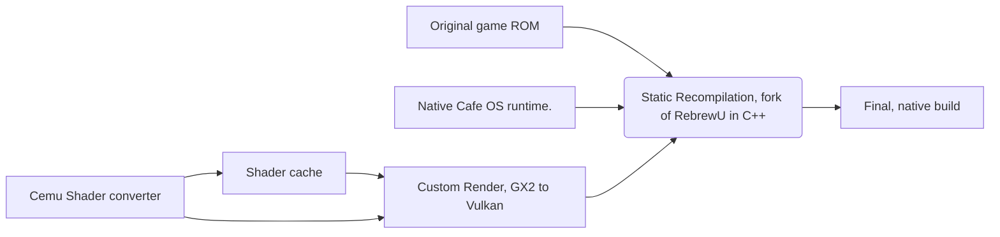

# Splatoon 1 🦑 PC Port
[](/CODE_OF_CONDUCT.md "Go to contributions doc")  [](https://www.linux.org/ "Go to Linux homepage") [](https://www.microsoft.com/ "Go to Microsoft homepage") [](https://) [](https://www.youtube.com/watch?v=TY3kYmz3RQM)
## The original repo is https://github.com/ApfelTeeSaft/RebrewU , Our Splatoon 1 PC Port is simply a continuation of ApfelTeeSaft's RebrewU Project

> IF YOU WANT TO HELP US DM `sussy_0897` IN DISCORD OR START A FORK (PREFERABLY DM ME ON DISCORD SINCE U MIGHT GET ADDED TO OUR TEAM), **Follow Code of conduct.md**
> IF YOU POST ANYTHING RELATED TO OUR PORT ON TIKTOK TAG @nevesboy67 @77emul AND @splatoon1multiplayer

An unofficial native PC port of **Splatoon (Wii U)** for **Windows and Linux**, made by statically recompiling the game's code into a native program, with a Vulkan renderer.

> **This project contains no Nintendo code, assets or game files.** You need your own copy of the game, dumped from your own Wii U. The setup builds the port on your PC from your files.

> ⚠️ **Work in progress.** Expect graphical glitches, missing effects, stutter and crashes. You need **strong hardware** (see below). If something goes wrong, please [open an issue](https://github.com/NEVESYA/SPLATOON-1-PC-PORT/issues). Include your PC specs and the text from the setup window or a screenshot. **AMD GPUs are not supported**, only NVIDIA

## Features

**Realistic graphics (experimental, off by default)**

Turn it on in the settings menu with *Graphics preset* (Balanced, Realistic or Cinematic); *Original* keeps the clean game at 60 FPS.
- The game's own lights follow a **time of day**: sunrise, golden hour, sunset and night with moon and stars, or the PC clock
- **Weather**: clear, overcast, rain, thunderstorm with lightning, after the rain (wet ground), or *Live*, where it changes by itself
- A physically based **sky** with **volumetric clouds**, two towering cumulus clouds, silver linings and **light shafts** through cloud gaps
- **Contact shadows**, ambient occlusion, bloom, edge smoothing (FXAA + TAA), motion blur, focus blur and colour controls (saturation, contrast, warmth, vignette, saved looks)
- Runs in the **plaza, Octo Valley and the tutorial**; story levels keep their own sky and lights and get the picture effects only

**Camera, cinema mode and PC controls**
- Field of view, camera distance and height, and a hand-held camera wiggle
- **Cinema mode**: no HUD and a free camera to fly anywhere for screenshots; **F12** saves a photo without menus
- Direct **PC mouse aiming** (1:1, like a PC shooter) and a key for every GamePad input
- Camera spots and character spawn points for testing

**HD textures (optional, built on your PC)**
- `HD-Textures` upscales the textures you saw while playing with Real-ESRGAN into `Game\textures`; nothing is downloaded or shared

**Releases for Windows and Linux**
- Each version tag publishes a Windows .zip and a Linux .tar.gz on the [Releases page](https://github.com/NEVESYA/SPLATOON-1-PC-PORT/releases) (source and setup only; you build the game from your own dump)

**Settings menu (Esc / controller touchpad)**
- Render resolution, Plaza 60 FPS on/off, frame rate (30 / 60 / 120 / 180), G-Sync / FreeSync, fullscreen, performance overlay
- **Graphics preset (experimental):** Original (the clean game at 60 FPS, the default), Balanced, Realistic, Cinematic; pages for graphics, weather & time, camera & mouse, and cinema/photo/hacks, with a help line for every option
- Gyro on/off, gyro and mouse sensitivity, invert gyro, volume
- Rebind every button for keyboard/mouse and controller
- HOME moved from Esc to H

**Performance**
- Plaza runs at 60 FPS with normal game speed (keeps NPCs)
- New frame rates in the menu (experimental): 120 and 180 FPS with real extra frames between game steps (180 outside the plaza), 30 FPS for weak PCs; game speed stays normal in all
- Fewer shader stutters, faster rendering in levels

---

## Requirements

- **Windows 10 or 11, 64-bit**, or a **64-bit Linux distribution**
- **Linux build tools** (the setup uses CMake end to end): CMake ≥ 3.20, Ninja or Make, GCC or Clang, Python ≥ 3.12, plus the `zlib`, `libcurl` and `vulkan-headers` development packages — Arch example: `sudo pacman -S --needed cmake ninja python gcc zlib curl vulkan-headers`. X11/Wayland headers are recommended so the game can open a window.
- **GPU with Vulkan 1.3** and an up-to-date driver (developed on an RTX 5060 Ti; a modern NVIDIA is recommended)
- **CPU:** modern 6–8 cores or more · **RAM:** 16 GB minimum, 32 GB recommended (building the game uses a lot of memory)
- **Disk:** about 40 GB free during setup FINAL BUILD IS 6GB COUNTING THE SHADER CACHES
- **Your own game dump:** Supported Splatoon version (see VersionDb.md), with the folders `code`, `content` and `meta` (for example made with *Dumpling* on your Wii U).

## Installation (Windows)

1. Click **Code → Download ZIP** on this page and extract it to a short path, for example `C:\SplatoonPort`.
2. Double-click **`Setup.bat`**.
   - If Visual Studio Build Tools, Python 3.12 or Git are missing, the setup offers to install them for you. Afterwards, close the window and run `Setup.bat` again.
3. When asked, select your **Splatoon dump folder** (the one containing `code`, `content` and `meta`). **The dump folder can have any name**; spaces and brackets such as `Splatoon [AGMP01]` are supported. Select the parent folder, rather than `code` or `content` inside it. Setup creates the Wii U folders automatically; there is no system-folder selection.
4. Wait. The first setup takes **30–90 minutes**: it builds the tools and recompiles your game.
5. Play: **`Game\Splatoon.exe`** (the setup can also create a desktop shortcut).

Setup creates the Wii U `mlc01` directory layout and the port's empty save folders automatically, like Cemu's initial setup. It uses existing local system fonts when available, or downloads Cemu's open-source Noto replacement fonts automatically (about 26 MB, with pinned checksums and their SIL OFL license). It never imports game saves, Mii save databases or console accounts. A fresh installation starts with no progress, and the game creates its save while you play.

Existing Mii graphics resources are detected automatically beside your game dump/repository, in `wiiu-system/mlc`, or in Cemu's default/configured MLC. These are optional to setup: missing resources produce a warning and may affect Mii graphics. Setup does not generate or download Nintendo's Mii graphics. Developers can optionally use `-Mlc "D:\My system dump"` to add a resource location; players are never prompted for it.

**Updating:** download the new version, then run `Setup.bat` again. Your save (`Game/save`) and shader cache are kept.

Options: `Setup.bat -Clean` rebuilds everything, and `-Output D:\Splatoon` picks a different game folder.

You can also pass folders directly, with quotes around paths that contain spaces:

```bat
Setup.bat -GameDump "D:\My Wii U games\Splatoon [AGMP01]"
```

## Installation (Linux)

1. Install the build tools (see [Requirements](#requirements)), for example on Arch:
   ```bash
   sudo pacman -S --needed cmake ninja python gcc zlib curl vulkan-headers
   ```
2. Extract the repository (or `git clone` it) anywhere and run the setup with your dump folder:
   ```bash
   ./setup.sh --dump "/path/to/SplatoonDump"
   ```
   The dump must contain `code`, `content` and `meta`. Without `--dump`, the setup looks in `~/Downloads` and `./dump`, then asks for the folder. It creates the Wii U `mlc01` layout, downloads the Noto replacement fonts (checksum-pinned), builds the dependencies, the recompiler and the game. The first run takes **30–90 minutes**.
3. Play: **`./Game/Splatoon`**.

Options: `./setup.sh --clean` rebuilds everything, `--output ~/Games/Splatoon` picks a different game folder, `--mlc PATH` adds a system-resource location, `--jobs N` sets the compile parallelism. Re-running the setup keeps your save (`Game/save`) and shader cache; run it again after pulling updates.

**Updating:** download the new version, then run `Setup.sh` again. Your save (`Game/save`) and shader cache are kept.

---

### Optional: HD textures

The game starts; visit the places you want in HD and close it. The textures it showed are then upscaled (Real-ESRGAN) into the `textures` folder next to the game and load at the next start. Everything happens on your PC from your own copy of the game; the HD textures are never uploaded or shared, because they are derived from the game's files.

- **Windows:** double-click `HD-Textures.bat`.
- **Linux:** run `./HD-Textures.sh` from the project folder (after `./setup.sh`).

Both need Python 3; the script offers to install `torch`, `numpy` and `pillow` with pip (on Linux you may need `python3-pip` from your distribution first). An NVIDIA graphics card with CUDA makes it many times faster than the CPU. Finished textures are kept, so you can stop and run it again later.

> **macOS** is not supported yet: the setup and the renderer have no macOS path (no MoltenVK build), so there is no macOS package or script.

### Building with CMake directly

`setup.sh` is a thin orchestrator over two CMake projects — `recompiler/` (the RebrewU tool) and `recompiler/port/` (the runtime and the game). The equivalent manual flow is:

```bash
# 1. RebrewU recompiler
cmake -S recompiler -B build/rebrewu -G Ninja -DCMAKE_BUILD_TYPE=Release
cmake --build build/rebrewu --target rebrewu

# 2. Recompile your dump into C++ (writes build/generated/Gambit).
#    The RPX selects its manifest from Manifest/*.manifest automatically.
build/rebrewu/bin/rebrewu recompile \
    --rpx "/path/to/dump/code/Gambit.rpx" --output build/generated/Gambit

# 3. Game (after ./setup.sh has built the SDL2/glslang dependency profile)
cmake -S recompiler/port -B build/game -G Ninja -DCMAKE_BUILD_TYPE=Release \
    -DRBREW_GRAPHICS_BACKEND=Vulkan -DRBREW_BUILD_GAME=ON \
    -DGAMBIT_GENERATED_DIR="$PWD/build/generated/Gambit" \
    -DSDL2_DIR=... -Dglslang_DIR=... -DCMAKE_PREFIX_PATH=...
cmake --build build/game --target Gambit
```

For incremental rebuilds just run **`./build.sh`** — it reuses the configured build trees and CMake re-runs itself when any `CMakeLists.txt` or `*.cmake` file changed.

## Controls

**Esc** (or the touchpad button of a PlayStation controller) opens the port's settings menu (ImGui): render resolution (applies at the next start), the graphics preset, plaza 60 FPS on/off, frame rate, G-Sync / FreeSync, fullscreen, performance overlay, controller gyro on/off, gyro sensitivity, inverted gyro up/down, mouse sensitivity, volume and quit. Two pages show and rebind every GamePad input for keyboard & mouse and for the controller: select a row, press Enter/Cross, then the new key or button (a key already in use swaps with the old one; Delete/Square clears; "Reset to defaults" restores the layout below). The game keeps running but gets no input while the menu is open. Choices are saved in `settings.ini` next to the game executable (`Splatoon.exe` / `Splatoon`); an environment variable that is set (for example `RBREW_PLAZA_60FPS`, `RBREW_GYRO`, `RBREW_RENDER_RESOLUTION`) still wins over the file.

**Graphics (experimental).** The default is the original look at 60 FPS. The *Graphics preset* turns on the new lighting: the game's own lights follow a time of day (sunrise, sunset, night with moon and stars) and the weather (clear, overcast, rain, thunderstorm, after the rain, or live), a physically based sky with volumetric clouds and light shafts, contact shadows, ambient occlusion, bloom, edge smoothing and colour controls. This runs in the plaza, Octo Valley and the tutorial; story levels keep their own sky and lights and get the picture effects only. The *Camera & mouse* page has direct PC mouse aiming (needs the game's Motion Controls on), field of view, camera distance/height and a camera wiggle. *Cinema, photo & hacks* hides the HUD and frees the camera (mouse to look, WASD to fly, Space/Ctrl up/down, Shift faster, F7 back), takes photos (**F12**, saved to `Screenshots`), and saves/restores camera spots and character spawn points. Every new effect has an environment switch back to the original behaviour (see `docs/performance.md`).

The game starts in borderless fullscreen; **F11** switches to a 1280×720 window and back. The TV scene renders internally at the console's **1280×720** (light on the GPU) and is scaled to the window. For a sharper image set `RBREW_RENDER_RESOLUTION` before starting: `native` (your desktop resolution), `1080p`, `1440p` or any `WIDTHxHEIGHT`. The game's camera and UI keep their original layout.

Controllers (Xbox, PlayStation or any SDL2 controller): buttons are mapped by position, like on the Wii U GamePad. The right stick controls the camera.

The tutorial keeps its original camera behavior, controlled with the **right stick or mouse**. Outside the tutorial, including the plaza, the port applies **neutral camera sensitivity (0)** automatically and uses the motion-control setting stored in your save (change it in the game options). It saves only the sensitivity and the updated checksum; progress, character data, camera inversion and other settings are preserved. The first edited save is backed up as `save.dat.before-control-defaults`. A new save is still created by the game normally.

Keyboard and mouse (default layout, rebindable in the menu):

| Input | Action |
|---|---|
| W A S D | Move |
| Mouse | Aim / camera |
| Left click | Shoot (ZR) |
| Right click | Squid form (ZL) |
| Space | Jump (B) |
| Q | Sub weapon |
| E | Special |
| F | Map (+) |
| G | Options (−) |
| Esc | Settings menu |
| H | Home |
| Tab | GamePad view (the mouse becomes the touch screen) NOT WORKING YET|
| F3 | Show/hide the debug overlay (ImGui windows: FPS, frame time, 1% low, frame-time graph, waits, RAM, shader compiles and diagnostics). |
| F8 / F9 | Start/stop an extended diagnostic recording / save a diagnostic snapshot to `Game/Diagnostics` |

## Runtime switches

| Category / Variable | Options / Default | Description |
| --- | --- | --- |
| **`RBREW_PAIRED_INLINE`** | `0` *(Default: compile-time decode)* | Restores interpreted paired-single instructions for A/B comparisons. |
| **`RBREW_QUERY_ASYNC`** | `0` | Forces all queued occlusion-query reads to wait. |
| **`RBREW_SCAN_COPY`** | `0` | Controls scan copy behavior. |
| **`RBREW_STICK_GYRO_YAW`** | `1` | Enables gyro yaw tied to the stick. |
| **`RBREW_AC_CONNECT`** | `ok` | Simulates the legacy online connection attempt at boot. |
| **`RBREW_BLEND_COMBINE_OLD`** | `1` | Uses the legacy blend combine method. |
| **`RBREW_SCAN_SLICE_MATCH`** | `0` | Disables scan slice matching. |
| **`RBREW_STREAMOUT_FLUSH_PUBLISH`** | `1` | Enables immediate stream-out flush publishing. |
| **`RBREW_FRAME_PACING`** | `0`, `auto`, `vsync` | Configures frame pacing: `0` (no flip pacing), `auto` (holds 30 FPS in heavy scenes), `vsync` (console-strict). |
| **`RBREW_AX_FILTERS`** | `0` | Disables AX audio filters. |
| **`RBREW_GYRO_INVERT_PITCH`** | `1` | Inverts gyro pitch control. |
| **`RBREW_GYRO_INVERT_YAW`** | `1` | Inverts gyro yaw control. |
| **`RBREW_STREAMOUT_EAGER`** | `1` | Uses legacy per-draw stream-out readback. |
| **`RBREW_IDLE_LOOKAROUND`** | `1` | Plays the inkling's look-around idle animation |
| **`RBREW_FPS_OVERLAY`** | `0` | Disables the FPS counter overlay. |
| **`RBREW_ASYNC_SHADERS`** | `0` | Waits for every shader compile instead of skipping the draw call. |
| **`RBREW_PLAZA_60FPS`** | `0`, `1` | Plaza frame rate mode: `0` (console-native 30 FPS), `1` (locked 60 FPS mode). |
| **`RBREW_FRAME_RATE`** | `30`, `60` | Frame rate (menu) |
| **`RBREW_FPS120`** | `interp` | 120 FPS mode (menu), beta |
| **`RBREW_STICK_GYRO_PITCH`** | `1` | Restores stick tilt |
| **`RBREW_GYRO`** | `0` | Disable DualSense Gyro |
| **`RBREW_QUERY_ASSUME_VISIBLE`** | `0` | Forces the plaza to wait for occlusion query results. |
| **`RBREW_CONTEXT_STATE_SYNC`** | `1` | Synchronizes context state. |
| **`RBREW_SUBMIT_EVERY_DRAWS`** | `0` | Disables submission on every draw call. |
| **`SPLATOON_DIAGNOSTICS`** | `off` | Disables automatic stutter report generation. |
| **`RBREW_INPUT_RECORD`** | `<file>` | Records every frame's GamePad input (buttons, sticks, touch, controller gyro, motion time step) along with scene-change markers to the specified file. |
| **`RBREW_INPUT_REPLAY`** | `<file>` | Replays a recorded input file, pausing at each scene change and loading screen until the game catches up, returning control upon completion or manual input. |
| **`RBREW_SAVE_DIR`** | `<dir>` | Specifies a custom save directory instead of `save`, allowing replays to start from the exact save file recorded with. |

## Why this project is legal

This project follows the same approach as other recompilation and decompilation projects:

- **No Nintendo material is in this repository.** There is no game code, no generated code, no textures, models, sounds, fonts, keys or firmware. It contains only original source code (the recompiler and the runtime) and open-source libraries under their own licenses (see `LICENSES/`).
- **You supply the game.** The port only works with a copy that you dumped yourself from a console and a game you own. The setup refuses unknown files.
- **The conversion happens on your own PC.** The recompiled code is created locally from your dump and is never uploaded or shared by this project.
- **Interoperability.** The runtime re-implements the Wii U system services (Cafe OS) in original code, so your game runs natively on your PC. This is the same kind of interoperability work that emulators like Cemu do.

Do not share your game files or the generated `build` folder. This explanation is not legal advice, and laws differ between countries. Only use games you legally own.

## How the port works



## Credits and licenses

Built with RebrewU (static recompiler), a Latte shader decompiler adapted from [Cemu](https://github.com/cemu-project/Cemu) (MPL-2.0), SDL2, glslang, volk, Vulkan-Headers, zlib, curl, miniaudio and nlohmann/json. Automatic replacement fonts are Noto Sans JP/SC/KR/TC Medium by Adobe, distributed with Cemu under SIL OFL 1.1. License texts are in `LICENSES/` and next to their sources.

*Splatoon is a trademark of Nintendo. This project is not affiliated with or endorsed by Nintendo.*
